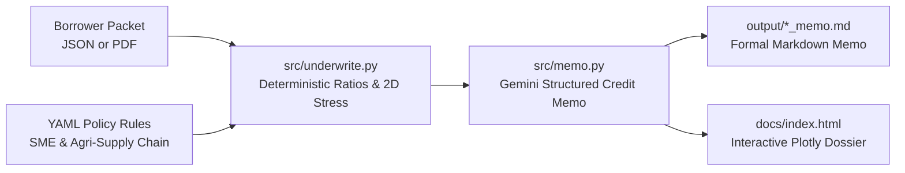

# Deterministic Credit Underwriting & Memo Engine

An institutional-grade commercial credit underwriting pipeline that separates **deterministic financial math & stress testing** from **structured Gemini Credit Committee Memo synthesis**.

**Live Underwriting Dossier:** [https://s-akoto.github.io/credit-memo-analyst/](https://s-akoto.github.io/credit-memo-analyst/)

---

## Architecture

## Core Capabilities & Design Principles

1. **Strict Separation of Arithmetic & Narrative (`src/underwrite.py`)**
   * Exact Python logic computes multi-year EBITDA, Pro-Forma DSCR, Pro-Forma Debt/EBITDA, Current Ratio, Interest Coverage, and working capital turnover days.
   * Executes a 25-scenario 2D sensitivity matrix (Revenue shocks `[r0, -20%]` x COGS inflation `[0%, +12%]`) plus a `+200/250 bps` interest-rate shock to identify sub-1.00x break-even thresholds before the LLM writes a single word.

2. **Configurable Policy Profiles (`config/`)**
   * `sme_commercial.yaml`: Small-business equipment and working capital term lending (DSOR >= 1.25x, Debt/EBITDA <= 3.50x).
   * `agri_supply_chain.yaml`: Seasonal grain aggregation and supply-chain working capital finance (DSCR >= 1.35x, Current Ratio >= 1.30x, higher commodity cost-spike stress testing).
