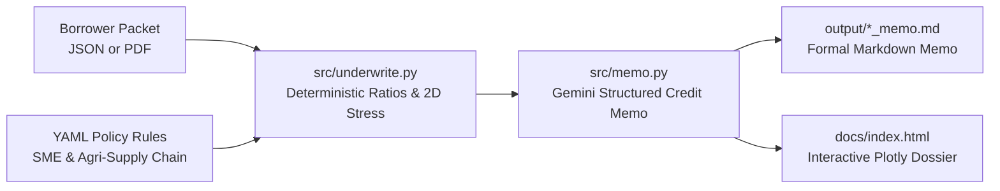

# Deterministic Credit Underwriting & Memo Engine

An institutional-grade commercial credit underwriting pipeline that separates **deterministic financial math & stress testing** from **structured Gemini Credit Committee Memo synthesis**.

**Live Underwriting Dossier:** [https://s-akoto.github.io/credit-memo-analyst/](https://s-akoto.github.io/credit-memo-analyst/)

---

## Architecture

## Core Capabilities & Design Principles

1. **Strict Separation of Arithmetic & Narrative (`src/underwrite.py`)**
   * Exact Python logic computes multi-year EBITDA, Pro-Forma DSCR, Pro-Forma Debt/EBITDA, Current Ratio, Interest Coverage, and working capital turnover days.
   * Executes a 25-scenario 2D sensitivity matrix (Revenue shocks `[r0, -20%]` x COGS inflation `[0%, +12%]`) plus a `+200/250 bps` interest-rate shock to identify sub-1.00x break-even thresholds before the LLM writes a single word.

2. **Configurable Policy Profiles (`config/`)**
   * `sme_commercial.yaml`: Small-business equipment and working capital term lending (DSOR >= 1.25x, Debt/EBITDA <= 3.50x).
   * `agri_supply_chain.yaml`: Seasonal grain aggregation and supply-chain working capital finance (DSCR >= 1.35x, Current Ratio >= 1.30x, higher commodity cost-spike stress testing).
h̸€¨©A�¥¹…¹�¥…°�A…�­•Ğ�%¹�•ÍÑ¥½¸€¡�ÍÉŒ½Á‘™}¥¹�•ÍйÁ値¨¨(€€€¨�áÑÉ…�ÑÌ�Õ¹ÍÑÉÕ�ÑÕÉ•��‰½ÉɽݕÈ�Á…�­•ÑÌ�¥¹Ñ¼�Í�¡•µ„µÙ…±¥‘…Ñ•���	½ÉɽݕÉA…�­•Ñ€�)M=8�™¥±•Ì�Ù¥„��ÁåÁ‘™€�…¹��•µ¥¹¤�ÍÑÉÕ�ÑÕÉ•��½ÕÑÁÕÑ̸((и€¨©Õѽµ…Ñ•��
É•‘¥Ğ�
½µµ¥ÑÑ•”�5•µ½Ì€˜�%¹Ñ•É…�Ñ¥Ù”�½ÍÍ¥•È€¡�ÍÉŒ½Á¥Á•±¥¹”¹Á値¨¨(€€€¨�•¹•É…Ñ•Ì�™½Éµ…°�5…É­‘½İ¸�µ•µ½Ì�¥¸��½ÕÑÁÕн€�…¹��„�µÕ±Ñ¤µ‰½ÉɽݕÈ�¥¹Ñ•É…�Ñ¥Ù”�!Q50�‘…Í¡‰½…É��¥¸��‘½�̽¥¹‘•à¹¡Ñµ±€�ݥѠ�A±½Ñ±ä�M
H�ÍÑÉ•ÍÌ�¡•…ѵ…ÁÌ�…¹���½Ù•¹…¹Ğ�Í�½É•�…ɑ̸((ŒŒ�1½�…°�M•ÑÕÀ()���‰…Í )ÁåÑ¡½¸Ì€µ´�Ù•¹Ø€¹Ù•¹Ø)ͽÕÉ�”€¹Ù•¹Ø½‰¥¸½…�Ñ¥Ù…Ñ”)Á¥À�¥¹ÍÑ…±°€µÈ�É•Åեɕµ•¹Ñ̹ÑáĞ()•áÁ½ÉĞ�5%9%}A%}-dô‰å½Õȵ…Á¤µ­•äˆ()AeQ!=9AQ ô¸�ÁåÑ¡½¸�ÍÉŒ½Á¥Á•±¥¹”¹Áä)½Á•¸�‘½�̽¥¹‘•à¹¡Ñµ°)��€(